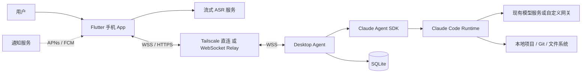
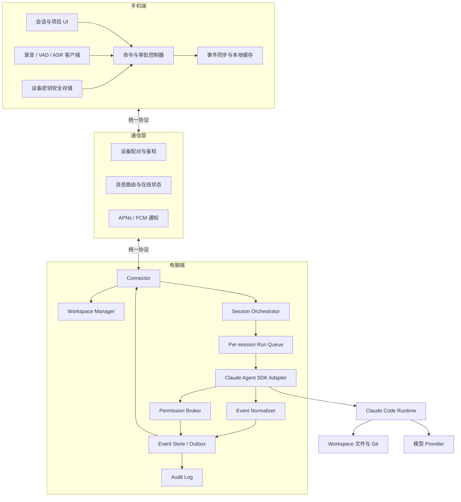
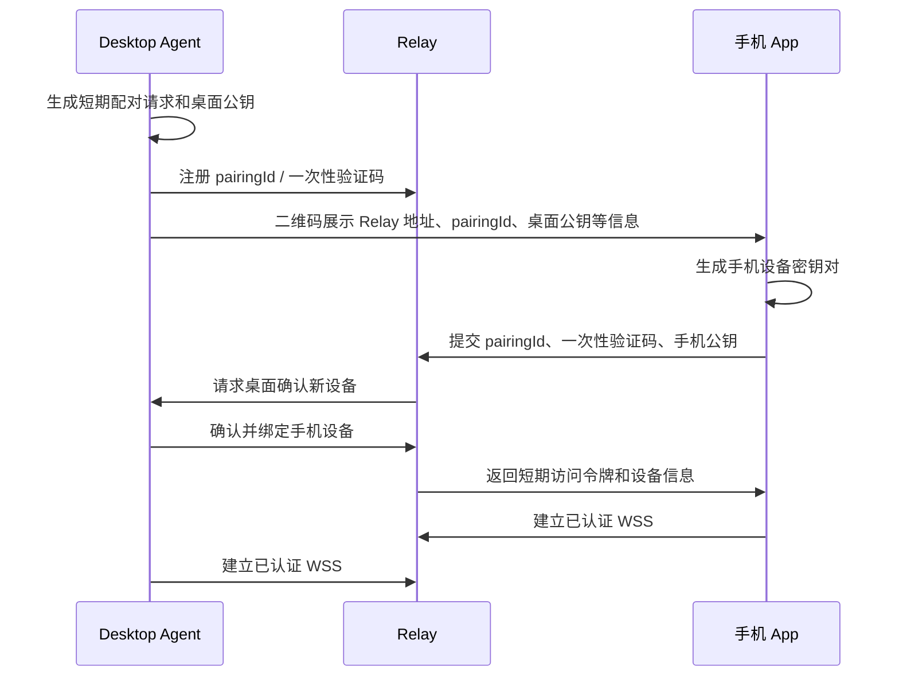
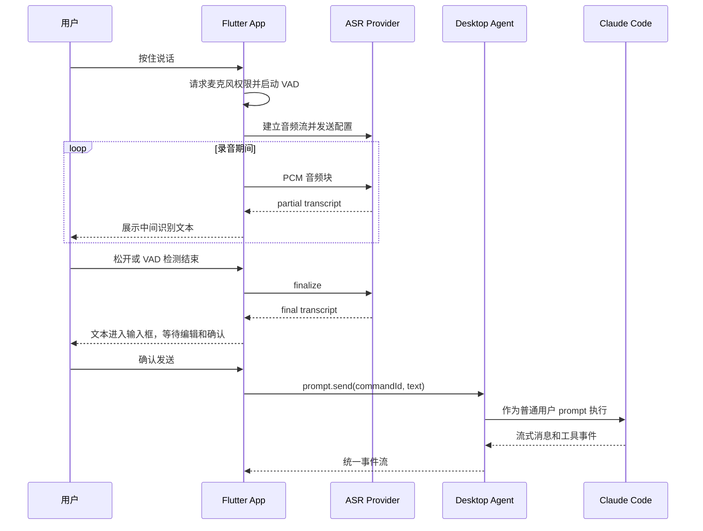
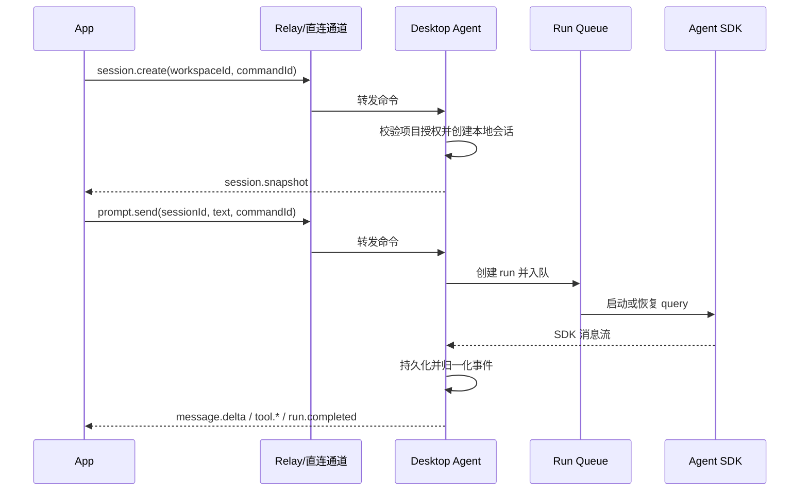
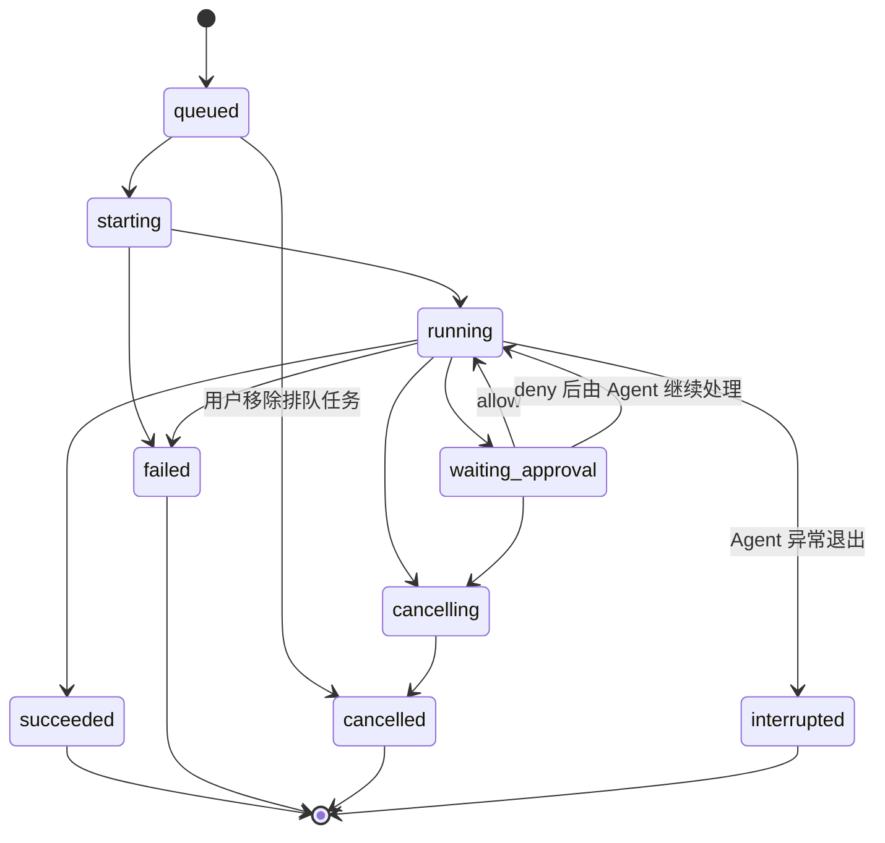

# Claude Code 手机远程控制系统架构设计

**文档版本：** V1.0  
**文档状态：** 设计评审稿  
**编制日期：** 2026-11-07  
**目标方案：** 方案 A——Flutter + Node.js/TypeScript + Claude Agent SDK  
**适用平台：** iOS、Android、macOS、Linux；Windows 作为后续扩展

---

## 1. 文档概述

### 1.1 背景

Claude Code 的官方 Remote Control 能将 Claude 手机 App 或 Web 界面连接到电脑上的本地会话，但其可用性依赖特定的登录方式、控制面和 API 接入路径。使用 API Key、自定义 `ANTHROPIC_BASE_URL`、第三方模型网关、Amazon Bedrock、Google Cloud Agent Platform 或 Microsoft Foundry 等配置时，不能直接依赖官方 Remote Control 满足需求。

本系统设计一套独立的手机远程控制壳，在不改变电脑端 Claude Code 模型配置的前提下，实现：

- 手机查看电脑和项目状态；
- 创建、恢复和管理 Claude Code 会话；
- 发送文字指令并接收流式输出；
- 查看工具调用、命令输出和文件修改；
- 在手机上批准或拒绝权限请求；
- 中断正在执行的任务；
- 通过语音识别输入指令；
- 断线重连后恢复会话状态。

### 1.2 设计原则

1. **电脑是执行中心：** Claude Code、代码仓库、模型凭据和工具执行均保留在电脑端。
2. **手机是控制终端：** 手机不保存模型密钥，不直接执行 shell，不依赖远程桌面。
3. **结构化协议优先：** 使用 Claude Agent SDK 和结构化事件，不抓取终端画面，不模拟键盘。
4. **默认安全：** 工作目录白名单、权限审批、超时拒绝、设备可吊销。
5. **先直连后中继：** MVP 可通过 Tailscale 直连；产品化版本增加 WebSocket Relay。
6. **语音只是输入方式：** ASR 输出必须转为可检查、可编辑的文本，再作为普通 prompt 发送。
7. **可恢复而非仅实时：** 所有关键事件持久化，支持重连、去重、补同步和审计。

### 1.3 建设目标

- 保留现有 Claude Code 模型、网关、环境变量和工具配置。
- 支持跨网络控制一台或多台已配对电脑。
- 支持同一电脑多个项目、多个会话，但单个会话串行执行。
- 手机断线或进入后台不中断电脑端任务。
- 权限请求能够可靠送达，断线期间默认不自动放行高风险工具。
- 语音输入支持中间识别结果、最终结果和发送前确认。

### 1.4 非目标

首版不包含：

- 远程桌面、屏幕镜像和完整终端仿真；
- 通过手机执行不受 Claude Code 权限体系约束的任意 shell；
- 多用户同时对同一会话进行写入；
- 在 Relay 上运行 Claude Code 或保存完整代码仓库；
- 后台持续录音和唤醒词监听；
- 自动批准部署、删除、Git 写操作等高风险行为；
- 完整的团队 RBAC、计费和多租户运营系统。

---

## 2. 约束与关键决策

### 2.1 外部约束

- Claude Agent SDK 与 Claude Code Runtime 存在版本耦合，需要固定兼容版本并进行升级回归。
- iOS 和 Android 不支持依赖普通后台 WebSocket 长期保活，后台通知必须使用 APNs/FCM。
- 电脑休眠、关机或断网时不能继续执行本地任务，App 必须明确显示电脑不可达。
- ASR 云服务的鉴权、音频格式和流式协议存在差异，需要 Provider 抽象。
- 用户现有模型配置可能依赖环境变量、本地凭据文件或企业网络，只能由 Desktop Agent 在本机加载。

### 2.2 核心决策

| 决策项 | 选择 | 理由 |
|---|---|---|
| Claude Code 接入 | Claude Agent SDK TypeScript | 提供结构化消息、会话恢复、流式输入和权限回调 |
| 手机框架 | Flutter + Riverpod | 一套代码覆盖 iOS/Android，UI 和录音能力一致 |
| 电脑端运行时 | Node.js 22+ + TypeScript | 与 Agent SDK 和 Relay 技术栈统一 |
| 控制通道 | WSS | 双向、低延迟，适合流式事件和审批 |
| 本地存储 | SQLite，开启 WAL | 部署简单，支持事件持久化和断线恢复 |
| 个人版网络 | Tailscale 直连 | 无公网端口，无 Relay 开发成本 |
| 产品版网络 | 出站 WSS Relay | 穿透 NAT，电脑端不开放入站端口 |
| 语音 | VAD + 流式 ASR + 文本确认 | 降低误识别直接触发工具执行的风险 |
| 桌面设置界面 | 可选 Tauri 2 | 提供托盘、配对和日志界面，不影响核心后台服务 |

---

## 3. 总体架构

### 3.1 系统上下文



### 3.2 逻辑容器



### 3.3 两种部署模式

#### 模式一：Tailscale 直连，MVP 默认

- Desktop Agent 仅监听 Tailscale 接口或受控本地地址。
- 手机和电脑登录同一 tailnet。
- 不部署 Relay、PostgreSQL 和推送服务。
- 适用于个人、单电脑和受信设备。
- 手机进入后台后无法接收实时事件，回到前台后执行增量同步。

#### 模式二：Relay 中继，产品化默认

- App 和 Desktop Agent 均主动向 Relay 建立 WSS。
- Relay 只负责身份、路由、在线状态和短期离线通知，不执行代码。
- Desktop Agent 是会话和事件的最终事实源。
- Relay 可水平扩展，但同一 Desktop Agent 只能存在一个有效控制连接。
- 对代码隐私要求较高时，在 TLS 之上增加设备级端到端加密。

---

## 4. 技术选型

| 层级 | 技术 | 用途 |
|---|---|---|
| App | Flutter、Dart | iOS/Android 客户端 |
| App 状态管理 | Riverpod | 会话状态、连接状态和审批状态管理 |
| App 录音 | `record` | PCM 音频采集与流式输出 |
| App 网络 | `web_socket_channel`、HTTP 客户端 | WSS 控制通道与 REST 引导接口 |
| App 安全存储 | `flutter_secure_storage` | 设备私钥、令牌和本机设置 |
| App 展示 | Markdown 与代码高亮组件 | 消息、Diff 和工具输出 |
| Desktop Agent | Node.js 22+、TypeScript | 本地控制服务 |
| Agent 接入 | `@anthropic-ai/claude-agent-sdk` | Claude Code 会话、工具和权限接入 |
| 本地网络 | Fastify + `ws` | 本地/直连 API 与 WebSocket |
| 数据校验 | Zod | 命令、事件和配置运行时校验 |
| 本地数据库 | SQLite + Drizzle 或 better-sqlite3 | 会话、事件、审批、幂等记录 |
| Relay | Node.js、TypeScript、Fastify、`ws` | 设备接入和双向消息路由 |
| Relay 数据 | PostgreSQL | 设备、配对和账号元数据 |
| Relay 临时状态 | Redis，可选 | 在线状态、连接路由、短期去重和限流 |
| 桌面 UI | Tauri 2，可选 | 托盘、配对二维码、项目授权和诊断 |
| 部署 | launchd、systemd | macOS/Linux 后台运行 |
| 语音 | 可插拔 ASR Provider | 云端或私有部署语音识别 |
| 通知 | APNs、FCM | 权限请求、任务完成和失败通知 |

---

## 5. 手机 App 设计

### 5.1 页面结构

1. **设备列表**
   - 电脑名称、在线状态、平台、最近心跳；
   - 配对、解除配对和重新连接；
   - 明确展示离线、休眠疑似和版本不兼容状态。

2. **项目列表**
   - 仅显示 Desktop Agent 已授权的项目；
   - 显示项目路径的脱敏名称、当前 Git 分支和会话数量；
   - 不允许 App 自由输入任意电脑路径。

3. **会话列表与详情**
   - 新建、恢复、重命名和归档会话；
   - 显示运行中、等待审批、已完成、失败和已取消状态；
   - 支持消息、工具调用、命令输出和 Diff 的时间线展示。

4. **任务控制**
   - 发送文本或语音识别文本；
   - 停止当前 run；
   - 查看排队消息；
   - 网络恢复后重新同步，而不是重复发送。

5. **权限审批**
   - 展示工具名称、完整输入、命令、工作目录和文件 Diff；
   - 支持允许一次、拒绝；
   - “始终允许”仅在后续版本通过明确、受限的规则实现；
   - 高风险操作可要求设备生物识别二次确认。

### 5.2 App 状态管理

建议按以下 State 划分 Riverpod Provider：

- `deviceConnectionState`：未配对、连接中、在线、重连中、离线；
- `workspaceListState`：项目快照；
- `sessionListState`：会话快照；
- `sessionTimelineState`：有序事件流；
- `activeRunState`：当前 run 和排队状态；
- `pendingApprovalState`：待审批请求；
- `voiceInputState`：空闲、录音、识别中、待确认、失败。

时间线必须按 `sessionId + seq` 排序，并通过 `eventId` 去重。不能仅按消息到达顺序渲染。

### 5.3 后台行为

- 语音采集和流式识别以 App 前台使用为前提。
- App 进入后台时关闭音频流，控制 WebSocket 可断开。
- 电脑端 run 不因 App 断开而自动停止。
- 回到前台后先获取快照，再使用 `afterSeq` 拉取增量事件。
- 产品版通过 APNs/FCM 通知用户返回 App；通知正文不携带敏感代码和命令。

---

## 6. Desktop Agent 设计

### 6.1 Connector

职责：

- 在直连模式提供受控 WSS 服务；
- 在 Relay 模式主动建立出站 WSS；
- 完成设备身份认证和协议版本协商；
- 维护心跳、重连和消息 Outbox；
- 拒绝未配对、已吊销或权限不足的设备；
- 对命令进行 Schema 校验、鉴权和幂等检查。

默认建议参数：

- 心跳间隔 15 秒；
- 45 秒未收到心跳判定连接失效；
- 指数退避重连并加入随机抖动；
- 所有时间参数均可配置，不与 Claude Code 内部超时耦合。

### 6.2 Workspace Manager

- 项目目录只能由电脑端用户授权添加。
- 保存 `workspaceId`、显示名和规范化真实路径。
- 使用真实路径检查，防止通过 `..` 或符号链接逃逸授权根目录。
- App 只能传递 `workspaceId`，不能指定任意 `cwd`。
- 可配置项目级工具策略和默认权限模式。
- 删除项目授权前，要求没有正在执行的 run。

### 6.3 Session Orchestrator

职责：

- 创建、恢复和归档本地会话；
- 保存本地 `sessionId` 与 Claude `claudeSessionId` 的映射；
- 管理每个会话的串行 run 队列；
- 调用 SDK Streaming Input、恢复和中断能力；
- 将 SDK 生命周期转换为统一状态机；
- 保证一个会话只有一个写入控制者；
- 防止终端和 App 同时向同一受管会话写入。

建议规则：

- 同一 `sessionId` 同时仅允许一个活跃 run；
- `prompt.send` 在忙碌时默认进入队列，也可配置为拒绝；
- `run.cancel` 只取消指定 `runId`；
- 取消当前 run 不自动删除已排队消息，需由用户明确处理；
- Agent 重启后，不将旧 run 直接标记成功，应标记为 `interrupted` 或 `unknown`，由用户决定恢复方式。

### 6.4 Claude Agent SDK Adapter

这是唯一允许依赖 Agent SDK 具体类型的模块，其他模块只使用内部统一协议。

主要职责：

- 创建 SDK `query()`；
- 传入工作目录、模型、权限模式及现有环境配置；
- 使用 Streaming Input 支持多轮会话；
- 保存和使用 Claude 会话 ID 进行 `resume`；
- 接收消息、工具调用、结果和错误；
- 将 `canUseTool` 请求转交 Permission Broker；
- 将取消命令转换为 SDK 中断；
- 处理 SDK 与 Claude Code Runtime 的版本检查。

不得在 Adapter 外直接传递 SDK 原始对象，以便未来升级 SDK 或增加 CLI stream-json 备用适配器。

### 6.5 Event Normalizer

将 SDK 事件归一化为：

- 助手消息增量；
- 完整消息；
- 工具开始、输出、完成和失败；
- 权限请求；
- run 状态变化；
- token/用量摘要，可选；
- 会话快照和控制面错误。

对高频输出进行有限合并，建议按 50–100 ms 或固定大小批量发送，同时保留事件顺序。大段工具输出应分块并支持截断预览，完整内容仍保存在电脑端。

### 6.6 Permission Broker

权限流程：

1. SDK 调用 `canUseTool`。
2. Broker 创建 `approvalId` 并持久化 `pending`。
3. 推送 `permission.requested` 到已连接 App。
4. 无在线 App 时，产品版发送轻量推送通知。
5. 用户提交 `permission.respond`。
6. Broker 校验设备、会话、run、审批状态和有效期。
7. 返回 SDK allow/deny 结果，并写入审计日志。

安全默认值：

- 超时默认拒绝；
- Desktop Agent 重启后未完成的审批默认失效，不自动放行；
- Read、Glob、Grep 等只读工具可按项目策略自动允许；
- Bash、Write、Edit 及外部网络操作默认需要按既有 Claude Code 权限规则处理；
- 不开放通过手机启用全局 `bypassPermissions`；
- “允许一次”和“永久规则”必须是不同命令、不同审计记录。

### 6.7 Event Store 与 Outbox

- 每个会话使用单调递增 `seq`；
- 事件先提交 SQLite，再异步发送；
- 发送失败不删除事件；
- App 可通过 `afterSeq` 补拉；
- `commandId` 去重记录与业务结果放在同一事务中；
- 按项目设置事件保留期和最大存储量；
- 清理历史事件前提供快照，避免老客户端无法同步。

---

## 7. Relay 与配对设计

### 7.1 Relay 职责

- 设备配对和身份验证；
- App 与 Desktop Agent 的 WebSocket 接入；
- 根据 `desktopId` 和连接代次路由消息；
- 在线状态和限流；
- 发送通知请求；
- 短期传输审计，不保存完整模型上下文。

Relay 不负责：

- 创建 Claude Code 进程；
- 决定工具权限；
- 保存模型密钥；
- 解释 prompt 或修改工具参数；
- 作为会话事件的最终事实源。

### 7.2 配对流程



配对二维码有效期建议为 5 分钟，一次性使用。 Relay 地址必须可信，生产环境还应防止二维码被替换。设备可单独吊销，吊销后令牌和已有连接均失效。

### 7.3 连接一致性

- Desktop Agent 每次新连接获得递增的 `connectionEpoch`。
- Relay 只接受最新代次的消息，避免旧连接脑裂。
- 同一会话的控制权通过 `controllerLease` 标识。
- 多部手机可以查看时间线，但同一时间只有具备控制租约的设备能发送 prompt 和审批。
- 控制租约超时不影响 Desktop Agent 本地安全策略。

---

## 8. 统一通信协议

### 8.1 通道划分

1. **REST 引导通道：** 配对、版本查询、设备列表和短期令牌获取。
2. **WSS 控制通道：** 命令、流式事件、审批和同步。
3. **ASR 音频通道：** 与主控制通道分离，避免音频阻塞控制消息。
4. **通知通道：** 仅发送通知类型和非敏感对象 ID。

### 8.2 消息信封

```json
{
  "protocolVersion": 1,
  "messageId": "msg_01J...",
  "commandId": "cmd_01J...",
  "traceId": "trace_01J...",
  "sourceDeviceId": "device_phone_01",
  "desktopId": "desktop_mac_01",
  "workspaceId": "ws_01J...",
  "sessionId": "session_01J...",
  "runId": "run_01J...",
  "seq": 128,
  "timestamp": 1762432800000,
  "type": "prompt.send",
  "payload": {
    "text": "检查这个项目的测试失败原因"
  }
}
```

不适用字段可以省略，但 `protocolVersion`、`messageId`、`timestamp`、`type` 和 `payload` 必须存在。事件必须包含 `eventId`；命令必须包含 `commandId`。

### 8.3 命令类型

| 命令 | 说明 |
|---|---|
| `workspace.list` | 获取已授权项目 |
| `session.create` | 在指定项目创建会话 |
| `session.resume` | 恢复本地会话 |
| `session.archive` | 归档会话，运行中禁止归档 |
| `session.snapshot` | 请求会话快照 |
| `session.sync` | 使用 `afterSeq` 请求增量事件 |
| `prompt.send` | 发送文本 prompt |
| `run.cancel` | 取消指定 run |
| `queue.remove` | 删除尚未开始的排队 prompt |
| `permission.respond` | 允许一次或拒绝指定审批 |
| `controller.acquire` | 获取会话控制租约 |

### 8.4 事件类型

| 事件 | 说明 |
|---|---|
| `session.snapshot` | 当前会话、run、队列和近期时间线快照 |
| `session.status` | 会话状态变化 |
| `run.queued` | prompt 已进入队列 |
| `run.started` | run 开始执行 |
| `message.delta` | 助手消息增量 |
| `message.completed` | 助手消息完成 |
| `tool.started` | 工具调用开始 |
| `tool.output` | 工具输出分块 |
| `tool.completed` | 工具调用完成或失败 |
| `permission.requested` | 新权限请求 |
| `permission.resolved` | 权限请求已处理或失效 |
| `run.completed` | run 成功、失败或取消的最终状态 |
| `desktop.status` | 电脑在线、运行环境和版本状态 |
| `error` | 结构化错误 |

### 8.5 同步与幂等

- 命令处理前先查询 `commandId`；重复命令返回首次处理结果。
- 事件以 `eventId` 去重，以 `seq` 排序。
- App 重连后发送最后连续收到的 `seq`。
- 如果本地事件已被清理，Desktop Agent 返回 `RESYNC_REQUIRED` 和新快照。
- 所有响应都关联原 `commandId` 和 `traceId`。
- Relay 重传不能改变消息 ID、序号或业务内容。

### 8.6 背压与大小限制

建议初始限制：

- 单条控制消息不超过 64 KiB；
- prompt 长度设置明确上限；
- 工具输出按块发送，单块建议不超过 32 KiB；
- 每个连接设置发送队列上限，超限时合并 delta，而不是无限占用内存；
- 快照和事件拉取使用分页；
- 大文件、完整日志和 Diff 后续通过短期授权下载接口传输，不嵌入 WebSocket 消息。

---

## 9. 语音子系统设计

### 9.1 语音处理链路



### 9.2 音频基线

- 16 kHz、单声道、PCM16 作为通用基线；
- Opus 等压缩格式作为 Provider 适配后的可选优化；
- 本地 VAD 用于结束检测和减少无效音频；
- 主控制 WebSocket 不传输音频二进制帧；
- App 退到后台或电话打断时立即停止采集；
- 默认不长期保存原始音频，仅保存用户确认后的文本。

### 9.3 ASR Provider 抽象

```typescript
interface AsrProvider {
  start(config: AsrStreamConfig): Promise<AsrStreamHandle>;
  write(handle: AsrStreamHandle, audio: Uint8Array): Promise<void>;
  finalize(handle: AsrStreamHandle): Promise<AsrFinalResult>;
  cancel(handle: AsrStreamHandle): Promise<void>;
}
```

Provider 实现可包括：

- 中文云 ASR，如流式 Paraformer 或讯飞类服务；
- 通用 Whisper/Realtime 类服务；
- 私有 FunASR 或 Whisper 服务端。

Provider 选择通过配置完成，不能改变 Claude Code 的 prompt 协议。

### 9.4 语音安全与体验

- 识别文本默认需要用户确认后发送；
- 不在语音层额外增加自动改写指令的 LLM，避免改变用户意图；
- 对识别置信度低或包含高风险意图的文本，明确要求用户检查；
- TTS 为后续功能，只播报任务摘要，不逐字播报流式日志；
- 停止 TTS 不等于停止 Claude Code run，界面必须提供独立停止按钮；
- 云 ASR 密钥仅保存在服务端；只有 Provider 支持临时令牌时才允许 App 直连。

---

## 10. 核心业务流程

### 10.1 创建会话并执行任务



### 10.2 权限审批

```mermaid
sequenceDiagram
    participant S as Agent SDK
    participant P as Permission Broker
    participant A as App
    participant DB as SQLite

    S->>P: canUseTool(toolName, input, requestId)
    P->>DB: 保存 pending 审批
    P-->>A: permission.requested
    alt 用户允许一次
        A->>P: permission.respond(allow_once)
        P->>DB: 原子更新为 approved
        P-->>S: allow
    else 用户拒绝或审批超时
        A->>P: permission.respond(deny)
        P->>DB: 原子更新为 denied/expired
        P-->>S: deny
    end
    P-->>A: permission.resolved
    S-->>P: 后续工具结果或 run 结果
```



### 10.3 断线恢复

1. App 记录每个会话最后连续事件的 `seq`。
2. 重连后请求 `session.snapshot` 和 `session.sync(afterSeq)`。
3. Desktop Agent 返回当前 run 状态、待审批状态和缺失事件。
4. App 以快照覆盖易失状态，以 `eventId` 去重合并事件。
5. 对未收到 ACK 的 `prompt.send` 使用原 `commandId` 查询或重试，不生成新命令。
6. 如果状态无法增量恢复，清空本地时间线并执行全量重同步。

---

## 11. 状态机设计

### 11.1 Run 状态



说明：拒绝工具请求不必然导致整个 run 失败，Claude Code 可能根据拒绝结果继续回复。因此 `deny` 后通常回到 `running`，最终状态由 SDK 结果决定。

### 11.2 Approval 状态

```text
pending → approved_once
pending → denied
pending → expired
pending → invalidated
```

状态更新必须原子化。已经完成的审批不能再次被另一部手机修改。

---

## 12. 数据模型

### 12.1 Desktop Agent SQLite

| 表 | 关键字段 | 说明 |
|---|---|---|
| `devices` | `device_id`、公钥、状态、最后连接时间 | 已配对手机 |
| `workspaces` | `workspace_id`、名称、真实路径、策略、状态 | 授权项目 |
| `sessions` | `session_id`、`claude_session_id`、`workspace_id`、状态、控制租约 | 本地与 Claude 会话映射 |
| `runs` | `run_id`、`session_id`、状态、prompt、时间、错误 | 执行记录 |
| `events` | `event_id`、`session_id`、`seq`、类型、payload、时间 | 有序事件日志 |
| `approvals` | `approval_id`、`run_id`、工具输入、状态、过期时间 | 权限审批 |
| `commands` | `command_id`、设备、类型、结果、时间 | 命令幂等 |
| `outbox` | `message_id`、目标设备、状态、重试次数 | 待发送消息 |
| `audit_logs` | 操作者、对象、动作、结果、traceId | 安全审计 |

关键索引：

- `events(session_id, seq)` 唯一索引；
- `commands(command_id)` 唯一索引；
- `approvals(approval_id)` 唯一索引；
- `runs(session_id, created_at)`；
- `audit_logs(created_at)`。

### 12.2 Relay PostgreSQL

只保存：

- 用户或组织标识；
- 手机与桌面设备元数据；
- 公钥、吊销状态和配对记录；
- 访问令牌摘要；
- 连接代次和在线元数据；
- 推送令牌及通知偏好。

默认不保存 prompt、完整消息、代码、Diff、工具输入和模型凭据。

### 12.3 App 本地数据

- 安全存储：私钥、访问令牌、设备 ID；
- 普通本地缓存：设备列表、会话摘要和近期时间线；
- 不保存模型密钥和 ASR 长期密钥；
- 用户退出或解除配对时清除敏感缓存。

---

## 13. 安全设计

### 13.1 身份与传输

- 所有公网通信使用 TLS/WSS。
- 设备使用独立密钥对，不使用所有设备共享的固定密码。
- 访问令牌短期有效，刷新令牌和私钥放入系统安全存储。
- 设备支持吊销，吊销后立即断开现有连接。
- Relay 使用 `connectionEpoch` 防止重复桌面连接。
- 产品化高隐私版本采用成熟协议或库实现端到端加密，不自行设计密码算法。

### 13.2 授权与工具安全

- 工作目录由电脑端授权，App 只能引用 `workspaceId`。
- Desktop Agent 对路径进行真实路径校验。
- 默认不启用全局 `bypassPermissions`。
- 高风险工具需要明确审批，审批展示完整参数。
- 所有审批超时、连接失效和 Agent 重启场景均默认拒绝或失效。
- 手机不能通过协议直接启动任意 shell 命令，只能发送 prompt 或响应 Claude Code 的权限请求。
- 多设备场景区分查看者和控制者。

### 13.3 数据保护

- 模型密钥、网关密钥和 ASR 长期密钥不进入 App。
- 日志默认脱敏，不记录完整环境变量、令牌、私钥和敏感文件内容。
- 推送通知不包含代码、完整命令或会话正文。
- 设置事件保留期、数据库大小上限和清理策略。
- 原始音频默认即识别即丢弃。
- 对模型服务和 ASR 服务分别提供隐私配置说明。

### 13.4 主要威胁与控制

| 威胁 | 控制措施 |
|---|---|
| 未授权手机控制电脑 | 一次性配对、设备密钥、吊销、短期令牌 |
| 重连导致 prompt 重复执行 | `commandId` 持久化幂等 |
| 伪造审批响应 | 设备鉴权、`approvalId`、状态原子更新、过期时间 |
| 任意目录访问 | 电脑端白名单、真实路径检查 |
| Relay 被入侵后执行命令 | Relay 无执行权限；高隐私模式使用端到端加密 |
| App 后台漏掉审批 | 推送通知、持久化 pending、重连同步 |
| 日志泄露密钥 | 字段脱敏、内容采样默认关闭、保留期 |
| 误识别触发危险任务 | ASR 文本确认、Claude Code 工具权限审批 |

---

## 14. 可靠性与容错

### 14.1 网络故障

- App 断线不停止电脑端 run。
- Desktop Agent 与 Relay 断线时继续本地执行并持久化事件。
- 恢复后通过 Outbox 和 `afterSeq` 补同步。
- Relay 不保证的事件持久性由 Desktop Agent 承担。
- 对长时间离线设备返回快照，而不是无限重放全部历史。

### 14.2 进程故障

- Node 服务崩溃后由 launchd/systemd 拉起。
- 启动时修复 SQLite 中未结束的命令和 Outbox 状态。
- 将重启前 `running`、`starting`、`waiting_approval` 的 run 标记为中断或状态未知。
- 不自动重放可能产生副作用的 prompt。
- 用户明确选择后，通过 Claude 会话恢复机制继续任务。

### 14.3 电脑休眠

- 心跳丢失后 App 显示电脑不可达。
- 桌面设置界面提供“任务期间防止休眠”的可选策略。
- 不承诺电脑断电或休眠后的任务连续性。
- 唤醒后重新注册 Relay，并同步当前状态。

### 14.4 版本兼容

- WebSocket 握手协商 `protocolVersion`。
- App、Desktop Agent、Agent SDK 和 Claude Code Runtime 分别上报版本。
- Desktop Agent 启动时执行 SDK/Runtime 兼容性检查。
- 不兼容时拒绝创建新 run，但保留查看本地历史的能力。
- 升级前执行协议和 SDK Adapter 回归测试。

---

## 15. 接口与错误码

### 15.1 代表性 REST 接口

```text
POST   /v1/pairings
POST   /v1/pairings/{pairingId}/confirm
POST   /v1/devices
DELETE /v1/devices/{deviceId}
GET    /v1/version
POST   /v1/auth/refresh
GET    /v1/workspaces
GET    /v1/sessions/{sessionId}/events?afterSeq=128&limit=200
```

实时操作统一走 WSS，避免同一业务同时存在 REST 和 WebSocket 两套写入路径。

### 15.2 错误码分类

| 错误码 | 含义 |
|---|---|
| `UNAUTHENTICATED` | 未认证或令牌失效 |
| `DEVICE_REVOKED` | 设备已吊销 |
| `FORBIDDEN` | 无项目或会话控制权限 |
| `WORKSPACE_NOT_ALLOWED` | 项目未授权 |
| `SESSION_BUSY` | 当前策略不允许排队 |
| `RUN_NOT_ACTIVE` | 要取消的 run 已结束 |
| `APPROVAL_EXPIRED` | 审批已过期 |
| `APPROVAL_ALREADY_RESOLVED` | 审批已处理 |
| `DUPLICATE_COMMAND` | 重复命令，响应中包含首次结果 |
| `RESYNC_REQUIRED` | 无法增量同步，需要快照 |
| `VERSION_INCOMPATIBLE` | 协议或运行时版本不兼容 |
| `DESKTOP_OFFLINE` | 电脑不可达 |
| `ASR_PROVIDER_ERROR` | 语音识别服务失败 |
| `RATE_LIMITED` | 请求超过限流 |
| `INTERNAL_ERROR` | 未分类内部错误，使用 traceId 排查 |

---

## 16. 可观测性与审计

### 16.1 日志

- 使用结构化 JSON 日志。
- 所有请求贯穿 `traceId`、`commandId`、`sessionId` 和 `runId`。
- 默认不记录完整 prompt、模型回复、音频、令牌和工具敏感参数。
- App 提供可主动导出的诊断包，导出前提示并进行脱敏。

### 16.2 指标

- Desktop/Relay 连接数、重连次数和心跳延迟；
- run 排队时长、执行时长、成功率和取消率；
- 每会话事件发送积压和数据库写入延迟；
- 权限审批等待时间、超时率和拒绝率；
- ASR 首字延迟、最终识别延迟和失败率；
- App 同步耗时、重复事件数和重同步次数；
- Relay 路由失败和无效连接代次数量。

### 16.3 审计

以下操作必须记录：

- 设备配对和吊销；
- 项目授权增加和移除；
- prompt 创建、取消和队列移除；
- 权限允许、拒绝、超时和失效；
- 控制租约获取和转移；
- 配置与版本变化。

---

## 17. 部署架构

### 17.1 电脑端

```text
Tauri 托盘/设置 UI（可选）
        │ localhost RPC + 本地认证
        ▼
Node.js Desktop Agent
        ├── SQLite
        ├── Agent SDK Adapter
        │       └── Claude Code Runtime
        │               ├── 本地项目目录
        │               └── 现有模型 Provider
        └── Tailscale 客户端或 Relay Connector
```

- macOS 使用 launchd，Linux 使用 systemd。
- Desktop Agent 以普通用户权限运行，不使用 root/Administrator 作为默认身份。
- Tauri UI 与后台服务通过仅本机可访问的接口通信。
- 自动更新必须验证签名；Node 服务与 Claude Code Runtime 版本协同升级。

### 17.2 Relay

- 无状态 WebSocket 服务可部署多个实例。
- Redis 保存在线路由、连接代次和限流状态；也可使用具备同等能力的消息系统。
- PostgreSQL 保存持久设备元数据。
- 负载均衡必须支持 WebSocket 和合理的空闲超时。
- APNs/FCM 由独立 Notification Worker 调用。
- Relay 部署环境不挂载用户代码目录，不配置模型凭据。

### 17.3 App

- iOS：声明麦克风权限，配置 APNs。
- Android：声明录音、网络和通知权限，配置 FCM。
- 首版不申请不必要的后台持续运行权限。
- 提供隐私说明，明确音频发送位置、保存策略和模型执行位置。

---

## 18. 测试策略

### 18.1 单元测试

- 协议 Schema 和版本兼容；
- 命令幂等与事件去重；
- run 和 approval 状态机；
- 项目真实路径校验；
- Outbox 重试和事件分页；
- ASR Provider 适配器。

### 18.2 集成测试

- 使用 Mock Agent SDK 验证消息、权限和中断流程；
- 使用固定 Claude Code 测试项目执行真实 SDK 冒烟测试；
- 使用 Mock ASR 验证 partial/final/cancel；
- 验证 SQLite 重启恢复和迁移；
- 验证 Relay 连接代次和设备吊销。

### 18.3 端到端测试

- 手机创建会话、发送 prompt、接收流式消息；
- 工具审批允许一次和拒绝；
- 任务执行中 App 断线、重连和补同步；
- 同一命令重复发送不产生第二次 run；
- Desktop Agent 重启后不自动重放任务；
- Relay 重启后桌面和手机恢复连接；
- 语音识别结果确认后只发送一次；
- 电脑离线、SDK 不兼容和 ASR 失败均有明确提示。

### 18.4 故障注入

- WebSocket 丢包、重复、延迟和乱序；
- App 进程被杀；
- Desktop Agent 进程被杀；
- SQLite 写入失败或磁盘空间不足；
- ASR 长时间无 final；
- 模型 Provider 超时；
- 审批响应与超时同时发生；
- 两部手机同时审批同一请求。

---

## 19. 分阶段实施计划

### 阶段 P0：技术验证

- 验证 Agent SDK 能继承目标自定义模型配置。
- 验证创建会话、Streaming Input、resume、中断和 `canUseTool`。
- 固定 Node、Agent SDK 和 Claude Code Runtime 版本。
- 输出最小 TypeScript Adapter 和事件样例。

**通过标准：** 一个测试项目可以完成两轮对话、一次工具审批和一次中断恢复。

### 阶段 P1：纯文字 MVP

- Flutter App、Tailscale 直连、Desktop Agent。
- 项目列表、会话创建/恢复、文字 prompt、流式事件、停止和审批。
- SQLite 持久化、命令幂等和基础审计。

**通过标准：** 在同一 tailnet 内完整执行一个包含文件修改的开发任务。

### 阶段 P2：可靠性

- 快照与增量同步、Outbox、重连、会话锁和控制租约。
- App 后台恢复、桌面服务开机启动和故障处理。
- 完整集成测试和故障注入。

**通过标准：** App 杀进程、断网和 Desktop Agent 重启均不会造成重复执行或错误审批。

### 阶段 P3：语音输入

- 录音、VAD、ASR Provider、partial/final 和文本确认。
- 音频打断、权限处理和识别失败恢复。

**通过标准：** 中文语音输入可编辑、可取消，确认后只生成一个 prompt。

### 阶段 P4：公网产品化

- Relay、设备配对与吊销、PostgreSQL、Redis、APNs/FCM。
- 限流、监控、备份和版本协商。
- 根据隐私要求实施端到端加密。

**通过标准：** 非同一局域网环境下可配对、控制、审批、接收通知并可靠恢复。

---

## 20. MVP 验收标准

1. 电脑端现有自定义模型配置无需迁移到手机或 Relay。
2. App 只能选择电脑端已授权的项目。
3. 文字 prompt 有流式响应，工具调用顺序正确。
4. 单会话任务串行执行，取消只影响指定 run。
5. 权限请求展示完整工具和输入，超时默认拒绝。
6. App 断线不终止任务，重连后无重复消息和重复执行。
7. Desktop Agent 重启不自动重放有副作用的任务。
8. 语音最终文本必须经用户确认后发送。
9. 模型密钥和 ASR 长期密钥不出现在 App 包、App 日志和 Relay 数据库中。
10. 所有配对、prompt、取消和审批操作可以审计。

---

## 21. 风险与应对

| 风险 | 影响 | 应对 |
|---|---|---|
| Agent SDK/Runtime 升级破坏兼容性 | 无法创建或恢复会话 | 固定版本、Adapter 隔离、升级回归 |
| 手机后台限制 | 无法实时收到审批 | 推送通知、持久化 pending、前台同步 |
| 电脑休眠或断网 | 任务中断或不可达 | 状态展示、防休眠选项、恢复协议 |
| WebSocket 重试导致重复任务 | 重复修改代码 | 持久化 `commandId` 幂等 |
| 多设备并发控制 | 状态和审批冲突 | 单会话队列、控制租约、审批原子状态 |
| ASR 误识别 | 指令偏离用户意图 | 文本确认、不自动改写、工具审批 |
| Relay 泄露代码或对话 | 隐私风险 | 最少存储、TLS、可选端到端加密 |
| 高频输出占满内存 | Agent 或 App 卡顿 | 分块、合并、背压和队列上限 |
| 事件无限增长 | 磁盘耗尽 | 保留期、快照、配额和清理 |
| 语音服务供应商锁定 | 成本和迁移困难 | ASR Provider 抽象和契约测试 |

---

## 22. 后续演进

- 完整 Diff 审查和选择性接受文件变更；
- Git worktree 隔离并行任务；
- 多项目任务看板和定时任务；
- 私有化 ASR 和本地 TTS；
- 团队 RBAC、组织策略和集中审计；
- 端到端加密 Relay 和零知识消息路由；
- Windows Desktop Agent；
- 受限文件附件和图片输入；
- CLI stream-json 备用适配器；
- 面向企业部署的策略签名和版本白名单。

---

## 23. 最终架构结论

本方案以 Desktop Agent 为可信执行边界，以 Claude Agent SDK 为结构化控制入口，以 Flutter App 为移动交互终端，以 WSS 为统一控制协议，以 SQLite 事件日志保证恢复能力，并通过可插拔 ASR 实现语音输入。

个人 MVP 推荐使用：

> Flutter + Tailscale + Node.js/TypeScript Desktop Agent + Claude Agent SDK + SQLite。

公网产品化推荐增加：

> WebSocket Relay + PostgreSQL + Redis + APNs/FCM + 设备配对与吊销。

语音、Relay 和桌面 UI 都不应侵入 Claude Code 核心控制逻辑。优先完成文字控制、流式事件、权限审批、中断恢复和幂等同步，再逐步增加语音与公网能力。

---

## 参考资料

- Claude Code Remote Control：https://code.claude.com/docs/en/remote-control
- Claude Code on mobile：https://docs.claude.com/en/docs/claude-code/mobile
- Claude Agent SDK 概览：https://code.claude.com/docs/en/agent-sdk/overview
- Agent SDK TypeScript 参考：https://code.claude.com/docs/en/agent-sdk/typescript
- Agent SDK Streaming Input：https://code.claude.com/docs/en/agent-sdk/streaming-vs-single-mode
- Agent SDK Sessions：https://code.claude.com/docs/en/agent-sdk/sessions
